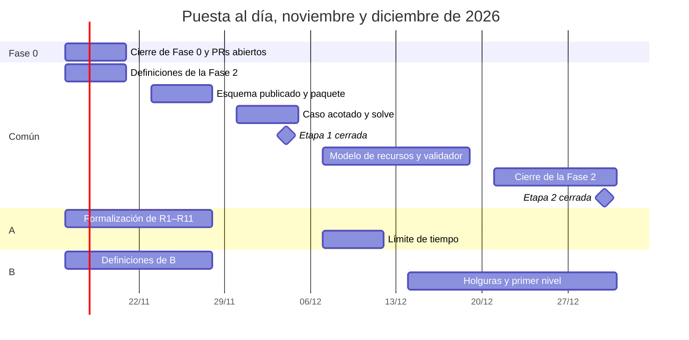

# Plan de puesta al día — noviembre y diciembre de 2026

> Público: el equipo del Proyecto Final (A y B) y cualquier agente que trabaje con ellos.
> Escrito el 2026-11-13. Se borra o se archiva cuando cierre la Fase 2.
>
> **Este archivo dice qué se hace, quién y en qué semana.** El estado de cada issue vive en Jira
> (proyecto `AUL`) y lo mueve el agente desde hechos de git (`convenciones.md` §7, decisiones 0024
> y 0025). Acá no se anota estado: si alguien no tiene el conector de Jira, mueve la issue a mano
> o lo dice en el PR (§7.5).

## Por qué hay que ponerse al día

Por pedido del director, las dos propuestas arrancan ahora en **agosto de 2026** y siguen
terminando en **junio de 2027** (once meses, M1 a M11). Al 2026-11-13 estamos en M4 y vamos unos
dos meses atrasados:

| Entregable | Debía estar | Al 2026-11-13 |
|---|---|---|
| Formalización final de R1–R11 | 30 sep. (fin de la etapa 1) | Avanzada en las decisiones 0001–0011 y 0015; falta el texto final |
| Esquema de instancia y de solución publicado | 30 sep. | No existe |
| Criterios de simulación de datos | 30 sep. | No existen |
| Caso de prueba acotado en formato de instancia | 30 sep. | No existe |
| Modelo de recursos, validador y línea de comandos | 31 dic. (fin de la etapa 2) | Sin empezar: `solver/` tiene solo el esqueleto |

El plan cierra la etapa 1 el **4 de diciembre** y la etapa 2 el **30 de diciembre**. La etapa 3
(diciembre a febrero) arranca entonces en enero, y su hito de febrero se mantiene.

## Cronograma

La semana del 16 de noviembre cierra lo que quedó abierto y toma las definiciones, porque sin
ellas no se puede escribir el esquema. El mayor riesgo es la línea de B: las holguras dependen del
modelo de recursos (AUL-45) y caen en la semana de las fiestas.

## Quién hace qué

Las tres personas del Proyecto Final: **A** (Proyecto A, una persona) y **B1** y **B2** (Proyecto
B). La base común se reparte entre las tres. La cuarta persona del equipo trabaja en la PPS (Fase
1) y sigue su propia línea; lo único que comparte con este plan es el esquema de instancia
(AUL-41, que cubre la parte del solver de AUL-17). Cada uno anota su nombre al lado de su rol la primera vez que toma una
issue, asignándosela en Jira.

| Rol | Issues | Semanas |
|---|---|---|
| **A** | AUL-38 objetivo del Proyecto A · AUL-37 límite de tiempo · AUL-40 formalización de R1–R11 | 16–27 nov. |
| | AUL-45 HU-2.2 restricciones de recursos · AUL-46 HU-2.4 límite de tiempo y estados | 7–18 dic. |
| | AUL-48 cierre de la Fase 2 (lo coordina A; firman los tres) | 21–30 dic. |
| **B1** | AUL-12 cierre de Fase 0 · AUL-33 adaptador de Gemini · AUL-20 esquema JSON · AUL-39 tipos alternativos | 16–20 nov. |
| | AUL-49 atenuables y unidad de infracción · AUL-41 publicar el esquema | 16–27 nov. |
| | AUL-44 HU-2.1 `aulero-solver solve` | 30 nov. – 4 dic. |
| | AUL-52 HU-7.1 holguras de R7 y R8 | 14–23 dic. |
| **B2** | AUL-36 criterios de simulación · AUL-42 HU-2.6 paquete instalable | 16–27 nov. |
| | AUL-50 formatos de infracciones · AUL-51 pesos y tope de sobrecupo | 23–27 nov. |
| | AUL-43 HU-2.5 caso de prueba acotado | 30 nov. – 4 dic. |
| | AUL-47 HU-2.3 validador independiente | 7–18 dic. |
| | AUL-53 HU-7.2 primer nivel | 21–30 dic. |

Por qué así:

- **A se queda con el modelo** (recursos, límite de tiempo, formalización): es el núcleo de su
  propuesta y lo que va a defender.
- **B1 se queda con el contrato de datos** (esquema y CLI) y con las holguras: las holguras se
  escriben sobre el esquema que B1 conoce mejor.
- **B2 se queda con los datos y la verificación** (simulación, caso acotado, validador) y con el
  primer nivel: el validador es el que después confirma las infracciones del primer nivel.
- La revisión humana de cada PR la hace alguien que no lo escribió (decisión 0014). Los PR #4 y #5
  y el de la decisión 0025 esperan esa aprobación desde ya.

## Dependencias que ordenan el trabajo

| Antes | Después |
|---|---|
| AUL-20 esquema JSON + AUL-39 tipos alternativos | AUL-41 publicar el esquema |
| AUL-36 criterios de simulación + AUL-41 esquema | AUL-43 caso acotado |
| AUL-41 esquema + AUL-42 paquete | AUL-44 `solve` |
| AUL-38 objetivo del Proyecto A + AUL-44 `solve` | AUL-45 restricciones de recursos |
| AUL-37 límite de tiempo | AUL-46 estados |
| AUL-45 recursos + AUL-49 atenuables | AUL-52 holguras |
| AUL-51 pesos + AUL-52 holguras | AUL-53 primer nivel |
| AUL-43 caso acotado + AUL-45 + AUL-47 | AUL-48 cierre de la Fase 2 |

## Cómo se trabaja con este plan, con cualquier agente

1. Tomá la próxima issue de tu rol cuyas dependencias estén cerradas. Asignátela en Jira.
2. Rama con la clave: `feat/AUL-45-restricciones-de-recursos`, `docs/AUL-40-formalizacion`. Las
   definiciones (`definicion`) se cierran con una decisión en `docs/decisiones/` antes de las
   historias que dependen de ellas.
3. Los criterios de aceptación y los casos borde de cada historia están en su issue y en
   `plan-de-fases.md` (Fases 2 y 7). Cada caso borde termina en un test que lo nombra.
4. Con Claude Code y el conector de Atlassian, el agente mueve el estado solo al abrir la rama, el
   PR y el merge. Con Codex o Antigravity, movelo a mano o dejalo dicho en el PR.
5. Si aparece trabajo que este plan no tiene, se clasifica con `convenciones.md` §7.3.

## Diferencias con `plan-de-fases.md` que quedan abiertas

- **HU-2.5** dice "9 materias de ISI"; las propuestas dicen 18 materias de dos carreras. AUL-43
  usa la versión de las propuestas. El plan se corrige cuando se aprueben las propuestas.
- La definición "Datos definitivos del juguete" de la Fase 2 la reemplaza AUL-36 (criterios de
  simulación), porque los datos ahora son simulados.
