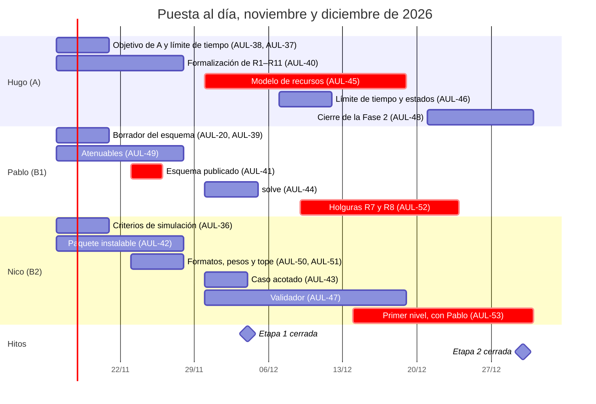

# Plan de puesta al día — noviembre y diciembre de 2026

> Público: el equipo del Proyecto Final (A y B) y cualquier agente que trabaje con ellos.
> Escrito el 2026-11-13. Se borra o se archiva cuando cierre la Fase 2.
>
> **Este archivo dice qué se hace, quién y en qué semana.** El estado de cada issue vive en Jira
> (proyecto `AUL`) y lo mueve el agente desde hechos de git (`convenciones.md` §7, decisiones 0024
> y 0025). Acá no se anota estado: si alguien no tiene el conector de Jira, mueve la issue a mano
> o lo dice en el PR (§7.5).

## Por qué hay que ponerse al día

Por pedido del director, las dos propuestas arrancan ahora en **agosto de 2026** y siguen
terminando en **junio de 2027** (once meses, M1 a M11). Al 2026-11-13 estamos en M4 y vamos unos
dos meses atrasados:

| Entregable | Debía estar | Al 2026-11-13 |
|---|---|---|
| Formalización final de R1–R11 | 30 sep. (fin de la etapa 1) | Avanzada en las decisiones 0001–0011 y 0015; falta el texto final |
| Esquema de instancia y de solución publicado | 30 sep. | No existe |
| Criterios de simulación de datos | 30 sep. | No existen |
| Caso de prueba acotado en formato de instancia | 30 sep. | No existe |
| Modelo de recursos, validador y línea de comandos | 31 dic. (fin de la etapa 2) | Sin empezar: `solver/` tiene solo el esqueleto |

El plan cierra la etapa 1 el **4 de diciembre** y la etapa 2 el **30 de diciembre**. La etapa 3
(diciembre a febrero) arranca entonces en enero, y su hito de febrero se mantiene.

## Cronograma

Las barras marcadas como críticas son el camino que no tiene margen: esquema (Pablo) → modelo de
recursos (Hugo) → holguras (Pablo) → primer nivel (Nico y Pablo) → cierre (Hugo). Cada paso es de
una persona distinta y espera al anterior.

## Quién hace qué

Las tres personas del Proyecto Final: **A es Hugo** (Proyecto A) y **B1 es Pablo** y **B2 es
Nico** (Proyecto B). La base común se reparte entre los tres, y cada issue ya está asignada a su
persona en Jira, con su fecha de vencimiento. La cuarta persona del equipo trabaja en la PPS
(Fase 1) y sigue su propia línea; lo único que comparte con este plan es el esquema de instancia
(AUL-41, que cubre la parte del solver de AUL-17).

Lo que va en negrita en **Entrega** es lo que destraba a otra persona: si se va a correr, se
avisa ese mismo día.

### Semana 1 — 16 al 20 de noviembre: definiciones, todos en paralelo

- **Hugo:** AUL-38 (objetivo del Proyecto A) y AUL-37 (límite de tiempo), cada una con su
  decisión registrada. Arranca AUL-40 (formalización).
- **Pablo:** AUL-20 y AUL-39, hasta un borrador del esquema acordado entre los tres. Arranca
  AUL-49 (atenuables). Propone la división del paquete `solver/` por persona (regla 3, abajo).
- **Nico:** AUL-36 (criterios de simulación) con su decisión. AUL-42 (paquete instalable).
- **Los tres:** revisar y mergear los PR #5, #6 y #7. Con eso, Pablo cierra AUL-12 (Fase 0).
- **Entrega, viernes 20:** el borrador del esquema, de Pablo a Hugo y a Nico.

### Semana 2 — 23 al 27 de noviembre: el esquema

- **Pablo:** AUL-41 (esquema publicado), idealmente el miércoles 25. Cierra AUL-49.
- **Hugo:** termina AUL-40. Arma el esqueleto del modelo contra el borrador (grilla, variables).
- **Nico:** cierra AUL-42. AUL-50 (formatos de infracciones, que extienden el esquema: se acuerdan
  con Pablo) y AUL-51 (pesos y tope). Junta los datos del caso acotado en una planilla, sin
  esperar al esquema.
- **Entrega, miércoles 25:** el esquema publicado, de Pablo a Hugo y a Nico.

### Semana 3 — 30 de noviembre al 4 de diciembre: cierre de la etapa 1

- **Nico:** AUL-43 (caso acotado en formato de instancia) para el jueves 3. Arranca AUL-47
  (validador): solo necesita el esquema de solución, no el solver.
- **Pablo:** AUL-44 (`solve`) sobre el paquete de Nico y el esquema.
- **Hugo:** AUL-45 (modelo de recursos): grilla, R5, R6 y exclusividad de aula. Necesita los
  modelos de datos del esquema, no la línea de comandos.
- **Entrega, jueves 3:** el caso acotado, de Nico a Hugo y a Pablo.
- **Hito, viernes 4: etapa 1 cerrada.**

### Semana 4 — 7 al 11 de diciembre: el modelo

- **Hugo:** AUL-45 suma R7, R8 con alternativos y R11. AUL-46 (límite de tiempo y estados).
- **Pablo:** conecta el `solve` al modelo de Hugo. Arranca AUL-52 (holguras) en una rama encima
  de la de Hugo.
- **Nico:** AUL-47, validador completo de recursos.
- **Entrega, miércoles 9:** la exclusividad de aula y R7, en la rama de Hugo, para Pablo.

### Semana 5 — 14 al 18 de diciembre: cerrar el modelo y el validador

- **Hugo:** AUL-45 con los tests de sus casos borde. PR y merge el viernes 18.
- **Nico:** PR de AUL-47, y el validador probado sobre soluciones reales del solver. Se suma con
  Pablo a AUL-53 (primer nivel).
- **Pablo:** AUL-52, holguras de R7 y R8.
- **Entrega, viernes 18:** el modelo de recursos mergeado; todo lo que sigue se apoya en él.

### Semana 6 — 21 al 23 y 28 al 30 de diciembre: cierre de la Fase 2

- **Pablo y Nico:** merge de AUL-52. AUL-53, primer nivel resolviendo el caso acotado.
- **Hugo:** AUL-48 (cierre de la Fase 2): `solve` en `FACTIBLE`, `validar` con cero violaciones,
  `informe-de-gestion.md` y `arquitectura.md` al día.
- **Hito, miércoles 30: etapa 2 cerrada.**

**Riesgo:** las semanas 5 y 6 caen en las fiestas, justo sobre el camino crítico. Si el 18 de
diciembre AUL-45 no está mergeado, AUL-53 pasa a la primera semana de enero en vez de forzarlo.

### Reglas para no frenar al otro

1. **Revisión en 48 horas, en ronda:** los PRs de Hugo los revisa Nico, los de Nico los revisa
   Pablo y los de Pablo los revisa Hugo (la aprobación de otra persona la exige la decisión 0014).
2. **Ramas apiladas:** si dependés de algo sin mergear, ramá encima de esa rama en vez de esperar.
3. **Cada uno con su parte de `solver/`:** el esquema y la línea de comandos Pablo, el modelo
   Hugo, el validador y las instancias Nico. La división exacta se registra como decisión en la
   semana 1, antes de AUL-41.
4. **Entrega en riesgo, aviso el mismo día:** cada una tiene a otra persona esperando.

## Dependencias que ordenan el trabajo

Están cargadas en Jira como vínculos "bloquea a".

| Antes | Después |
|---|---|
| AUL-20 esquema JSON + AUL-39 tipos alternativos | AUL-41 publicar el esquema |
| AUL-36 criterios de simulación + AUL-41 esquema | AUL-43 caso acotado |
| AUL-41 esquema + AUL-42 paquete | AUL-44 `solve` |
| AUL-38 objetivo del Proyecto A + AUL-41 esquema | AUL-45 restricciones de recursos |
| AUL-41 esquema | AUL-47 validador |
| AUL-37 límite de tiempo | AUL-46 estados |
| AUL-45 recursos + AUL-49 atenuables | AUL-52 holguras |
| AUL-51 pesos + AUL-52 holguras | AUL-53 primer nivel |
| AUL-43 caso acotado + AUL-45 + AUL-47 | AUL-48 cierre de la Fase 2 |

AUL-45 depende del esquema y no del `solve`: el modelo usa los modelos de datos, y la línea de
comandos es una capa fina que se le pone encima. Eso deja correr AUL-44 y AUL-45 en paralelo.

## Cómo se trabaja con este plan, con cualquier agente

1. Tomá la próxima issue tuya (ya están asignadas en Jira, con fecha) cuyas dependencias estén
   cerradas. Jira las muestra como "bloqueada por".
2. Rama con la clave: `feat/AUL-45-restricciones-de-recursos`, `docs/AUL-40-formalizacion`. Las
   definiciones (`definicion`) se cierran con una decisión en `docs/decisiones/` antes de las
   historias que dependen de ellas.
3. Los criterios de aceptación y los casos borde de cada historia están en su issue y en
   `plan-de-fases.md` (Fases 2 y 7). Cada caso borde termina en un test que lo nombra.
4. Con Claude Code y el conector de Atlassian, el agente mueve el estado solo al abrir la rama, el
   PR y el merge. Con Codex o Antigravity, movelo a mano o dejalo dicho en el PR.
5. Si aparece trabajo que este plan no tiene, se clasifica con `convenciones.md` §7.3.

## Diferencias con `plan-de-fases.md` que quedan abiertas

- **HU-2.5** dice "9 materias de ISI"; las propuestas dicen 18 materias de dos carreras. AUL-43
  usa la versión de las propuestas. El plan se corrige cuando se aprueben las propuestas.
- La definición "Datos definitivos del juguete" de la Fase 2 la reemplaza AUL-36 (criterios de
  simulación), porque los datos ahora son simulados.
